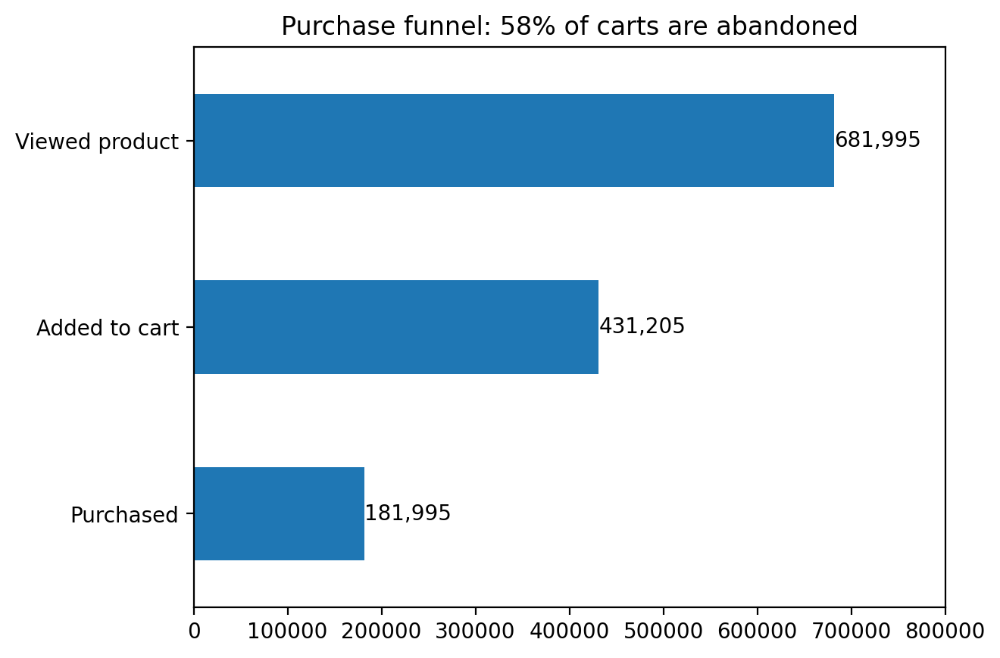
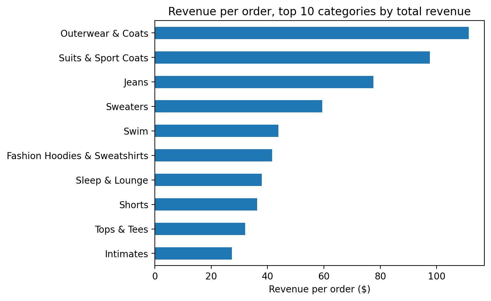
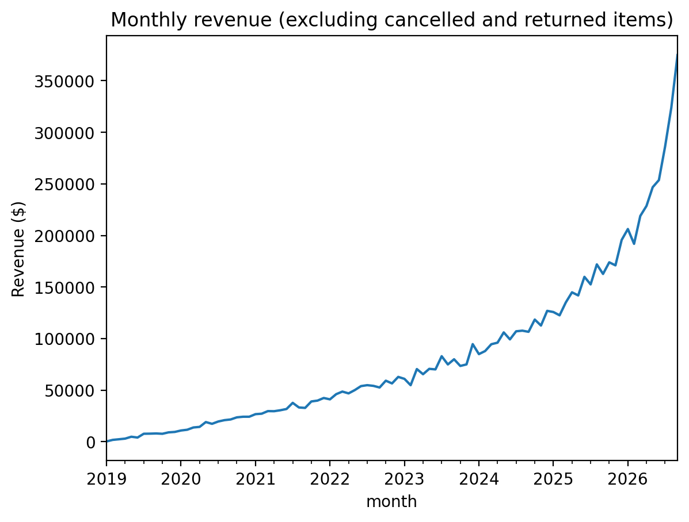

# E-commerce Funnel Analysis (SQL / BigQuery)

## Overview
An analysis of an online clothing store's customer funnel, traffic sources, product categories, and repeat purchases. 

Main question: **where do customers drop off between browsing and buying, and what brings them back?**

## Data and tools
- **Data:** Google's public TheLook e-commerce dataset in BigQuery (`bigquery-public-data.thelook_ecommerce`), a synthetic online clothing store with about 125K orders and 680K website sessions
- **SQL (BigQuery):** for all the analysis
- **Python (pandas, matplotlib):** for the charts

## What I found

**1. Most people who add something to their cart don't buy it.**
Of the 431,205 sessions where someone added an item to their cart, only 181,995 ended in a purchase. That means about **58% of carts were abandoned**, which was the biggest drop-off in the funnel.

**2. Where visitors came from didn't change whether they bought.**
All five traffic sources converted at nearly the same rate, between 26.5% and 26.8%. The real difference was volume: Email brought in almost half of all sessions (45%).

**3. Coats and suits bring in the most money per order.**
Outerwear & Coats was the top category by revenue even though several categories had more orders, because each order averaged about $111. Suits were close behind at about $98. Cheaper categories like hoodies and loungewear sold often but brought in about $40 per order.

**4. Most buyers only ordered once.**
Out of 66,374 customers, only 30.6% came back for a second order, and the ones who did waited about 14 months on average.

**Context:** the store's monthly revenue grew a lot over time, from almost nothing in 2019 to about $375K in September 2026.

## What I'd suggest
- Test ways to get people through checkout, like reminder emails for abandoned carts
- Use email (already the biggest channel) to bring first-time buyers back sooner
- Promote high-value categories like coats and suits

## Limitations
This is generated practice data, and some things looked too clean to be real:
- Every single session included a product view, which wouldn't happen on a real website.
- About 27% of sessions ended in a purchase. Real online stores are usually closer to 2–3%.
- Conversion rates by channel and return rates by category (about 10%) were almost identical everywhere.

Two other things to keep in mind:
- The repeat-buyer rate is probably too low, because customers who bought recently haven't had time to come back yet.
- The dataset updates daily, so rerunning the queries gives slightly different numbers. Mine are from October 2026, and I left the unfinished current month out of the revenue chart.

## Methods
- **Funnel analysis:** counted distinct sessions reaching each step (product view, cart, purchase) using conditional aggregation
- **Segmentation:** broke conversion down by traffic source with `GROUP BY`
- **JOINs:** combined order items with the product table to analyze revenue and returns by category
- **CTEs and window functions:** used `ROW_NUMBER` and `LAG` to number each customer's orders and measure the time between them

## Files
| File | What it does |
|---|---|
| `01_total_orders.sql` | Counts total orders |
| `02_monthly_revenue.sql` | Revenue by month |
| `03_funnel.sql` | Sessions at each step of the funnel |
| `04_funnel_by_source.sql` | Funnel broken down by traffic source |
| `05_category_revenue_returns.sql` | Revenue and return rate by category (JOIN) |
| `06_repeat_customers.sql` | Repeat buyers and time to second order (CTE + window functions) |
| `*.csv` | Query results exported from BigQuery |
| `charts.ipynb` | Python code for the charts |
